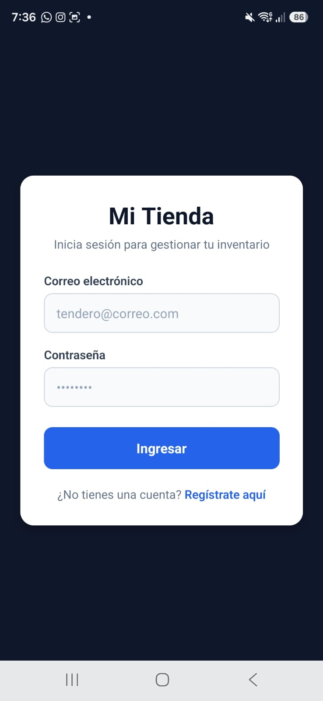
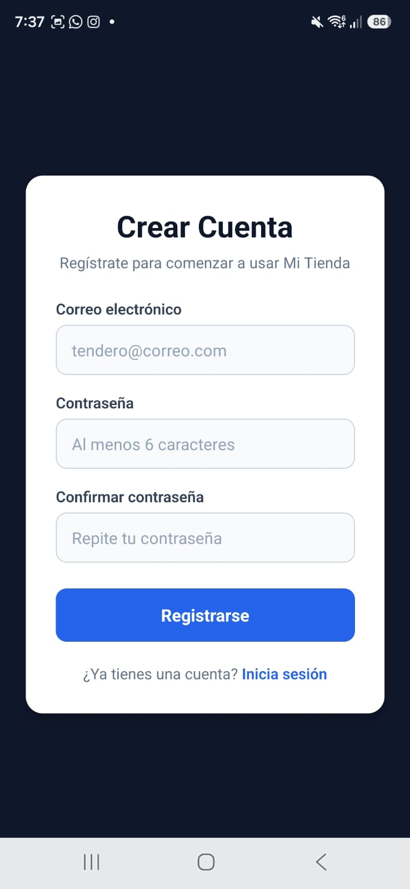
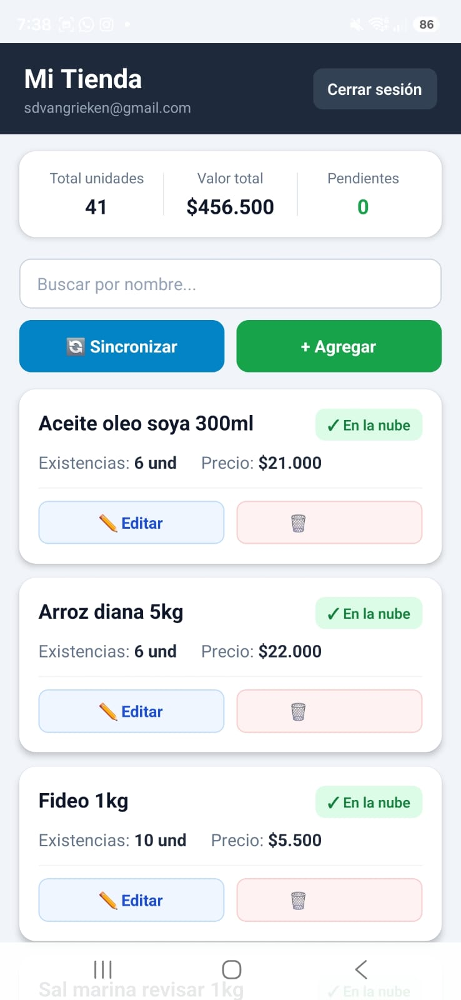
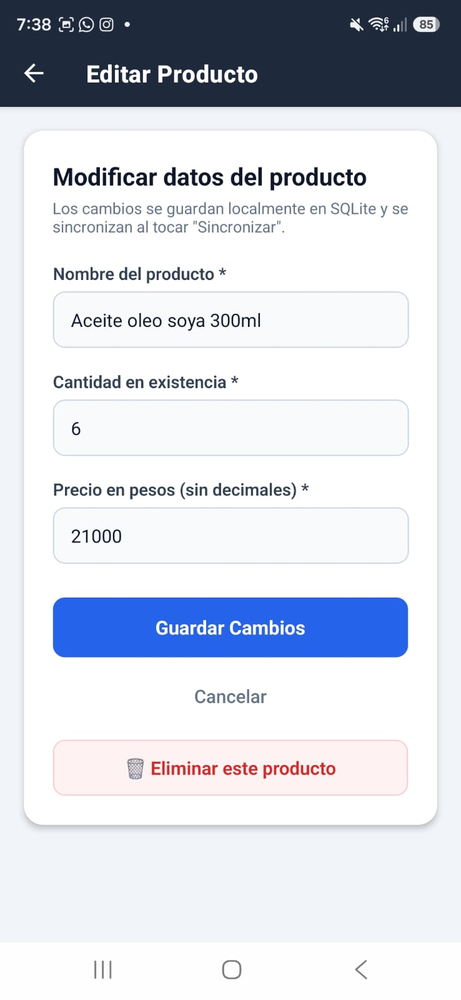
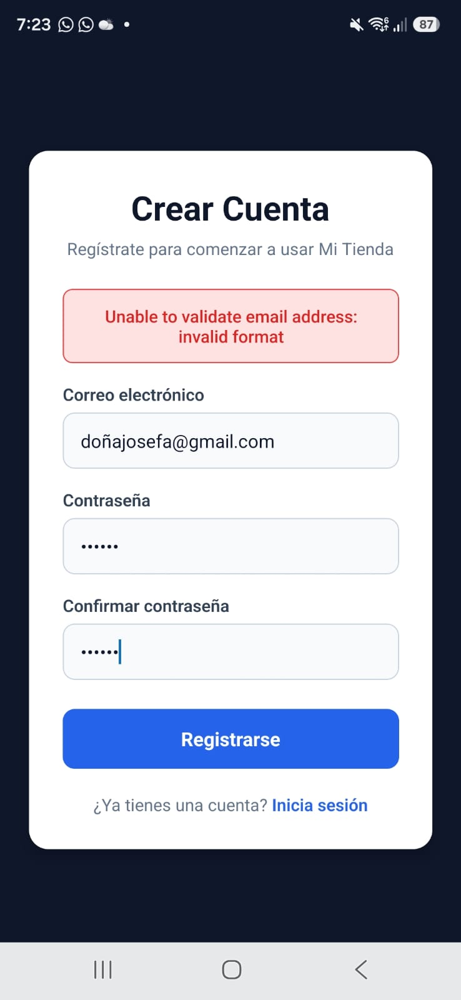

# Mi Tienda — App móvil con base de datos local y en la nube

**Desarrollo Móvil — Segundo Parcial**  
- **Estudiante:** Ramiro Jose Gomez Agamez  
- **Repositorio sugerido:** `parcial-mi-tienda-gomez`

---

## 🛠️ Tecnologías Utilizadas

- **React Native / Expo** (SDK 58) con **TypeScript**
- **Expo Router** (Navegación declarativa y rutas protegidas con Stack)
- **SQLite + Drizzle ORM** (`expo-sqlite`, `drizzle-orm`, `drizzle-kit`) como fuente de verdad local reactiva (`useLiveQuery`)
- **Supabase** (`@supabase/supabase-js`) como respaldo en la nube con Row Level Security (RLS)
- **Expo SecureStore** con adaptador por fragmentos para persistencia segura de la sesión

---

## 🚀 Cómo ejecutar el proyecto

### 1. Clonar el repositorio
```bash
git clone https://github.com/<usuario>/parcial-mi-tienda-gomez.git
cd parcial-mi-tienda-gomez
```

### 2. Instalar dependencias
```bash
npm install --legacy-peer-deps
```

### 3. Configurar variables de entorno
Crea un archivo `.env` en la raíz del proyecto tomando como referencia `.env.example`:
```env
EXPO_PUBLIC_SUPABASE_URL=https://ywmgiccnjvblmneuiupn.supabase.co
EXPO_PUBLIC_SUPABASE_PUBLISHABLE_KEY=sb_publishable_9DbBULuPweJNySgHmw5SFg_FBCD23Ea
```

### 4. Ejecutar el SQL en Supabase
En el SQL Editor del proyecto de Supabase, ejecuta el siguiente script para crear la tabla y configurar las políticas de seguridad (RLS):

```sql
create table public.products (
  id bigint generated always as identity primary key,
  user_id uuid not null default auth.uid() references auth.users (id) on delete cascade,
  client_id uuid not null unique,
  name text not null,
  quantity integer not null check (quantity >= 0),
  price integer not null check (price >= 0),
  updated_at timestamptz not null,
  created_at timestamptz not null default now()
);

alter table public.products enable row level security;

create policy "ver los míos" on public.products
  for select to authenticated using ((select auth.uid()) = user_id);

create policy "crear los míos" on public.products
  for insert to authenticated with check ((select auth.uid()) = user_id);

create policy "editar los míos" on public.products
  for update to authenticated
  using ((select auth.uid()) = user_id)
  with check ((select auth.uid()) = user_id);

create policy "borrar los míos" on public.products
  for delete to authenticated using ((select auth.uid()) = user_id);
```

> **Importante:** Desactivar la opción "Confirm email" en Supabase Auth (`Authentication -> Providers -> Email`) para permitir el acceso directo tras el registro.

### 5. Iniciar la aplicación
```bash
npx expo start
```
Abre la aplicación escaneando el código QR con **Expo Go** en tu dispositivo físico Android/iOS, o en un emulador.

---

## 📸 Evidencias y Capturas de Pantalla

### 01. Pantalla de inicio de sesión


### 02. Pantalla de registro con validación visible


### 03. Pantalla principal (inventario) con 3 productos, totales e indicadores


### 04. Formulario editando un producto existente


### 05. Producto creado en modo avión (pendiente de sincronización)


### 06. Pantalla principal tras sincronizar (con mensaje de resultado)


### 07. Panel de Supabase con la tabla `products` y las filas del usuario


---

## 📋 Estado del proyecto: Funcionalidades implementadas

- [x] **Autenticación completa:** Registro y Login con Supabase Auth y persistencia segura en `SecureStore` (sobrevive al cerrar la app).
- [x] **Rutas protegidas:** Si no hay sesión, sólo se permite acceso a Login y Registro; si hay sesión iniciada, se redirige a la pantalla principal.
- [x] **Base de datos local offline-first:** SQLite manejado con Drizzle ORM y migraciones automáticas (`useMigrations`).
- [x] **CRUD en modo avión:** Creación, edición y eliminación de productos funcionan 100% sin conexión a internet.
- [x] **Lista reactiva:** Actualización inmediata con `useLiveQuery` en la pantalla principal.
- [x] **Métricas de inventario:** Total de unidades en existencia, valor monetario total del inventario y contador de productos pendientes de sincronizar.
- [x] **Sincronización bidireccional:** Botón "Sincronizar" que baja productos de la nube (insertando los faltantes sin duplicar) y sube los productos locales pendientes con `upsert`.
- [x] **Punto extra - Búsqueda por nombre:** Filtrado instantáneo en tiempo real en la pantalla principal.
- [x] **Punto extra - Resolución de conflictos:** Regla "gana el último cambio" comparando marcas de tiempo (`updated_at`).

